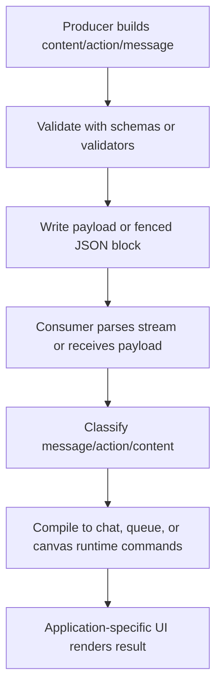

# @gg-utils/chat-comms

Reusable Assistant-to-UI chat protocol contracts, schemas, builders, validators, fixtures,
stream helpers, and headless runtime helpers.

Use this package when an application needs a stable wire contract between a protocol producer
(agent, server, or worker) and a UI consumer (chat surface, canvas surface, queue processor, or
debug tooling). Application storage, authentication, rendering policy, and transport ownership stay
in the consuming app.

## Install

This repository is published as a public Git package.

```bash
npm install @gg-utils/chat-comms@git+https://github.com/gg-utils/chat-comms.git#main
```

For reproducible applications, pin a commit SHA instead of `main`:

```json
{
  "dependencies": {
    "@gg-utils/chat-comms": "git+https://github.com/gg-utils/chat-comms.git#80a01c8"
  }
}
```

## When To Use

- You need shared message, content, action, canvas, app-action, or queue wire types.
- You need Zod schemas or strict/loose validators for protocol payloads.
- You need builders that generate protocol-compliant chat messages, actions, and content items.
- You need helpers for parsing fenced JSON protocol blocks from streamed markdown.
- You need headless runtime helpers that compile protocol actions into UI commands.

Skip this package when you only need app-specific UI components, persistence, API transport, or
authentication.

## Public Surfaces

| Import | Purpose |
|---|---|
| `@gg-utils/chat-comms/wire` | Wire literals, token lists, and protocol constants. |
| `@gg-utils/chat-comms/types` | Canonical TypeScript protocol types. |
| `@gg-utils/chat-comms/options` | Builder option contracts. |
| `@gg-utils/chat-comms/builders` | Message/content/action builders and ID utilities. |
| `@gg-utils/chat-comms/schemas` | Zod schemas for strict runtime validation. |
| `@gg-utils/chat-comms/validators` | Strict and loose parse/classification helpers. |
| `@gg-utils/chat-comms/stream` | Fenced JSON writer/parser and stream-summary helpers. |
| `@gg-utils/chat-comms/runtime/chat` | Headless chat command compilation and content utilities. |
| `@gg-utils/chat-comms/runtime/queue` | Queue wait normalization and completion helpers. |
| `@gg-utils/chat-comms/runtime/canvas` | Canvas action reducer/command helpers. |
| `@gg-utils/chat-comms/fixtures` | Positive and negative protocol fixtures. |
| `@gg-utils/chat-comms/animation` | Panel animation trigger/type helpers. |

There is intentionally no package-root export. Import the subpath that matches the protocol layer
you need.

## Quick Start

```ts
import { ChatComms_Builder_buildChatMessage } from "@gg-utils/chat-comms/builders";
import { ChatComms_Validator_parseMessageStrict } from "@gg-utils/chat-comms/validators";
import { ChatComms_Wire_MessageRoles } from "@gg-utils/chat-comms/wire";

const message = ChatComms_Builder_buildChatMessage({
  message_id: "msg-1",
  message_role: ChatComms_Wire_MessageRoles.PROTOCOL_MESSAGE_ROLE_ASSISTANT,
  message_contents: [
    {
      content_id: "content-1",
      content_queue: "main",
      content_type: "CHAT_CONTENT_MARKDOWN",
      content_data: { markdown: "Ready." },
    },
  ],
});

const parsed = ChatComms_Validator_parseMessageStrict(message);
if (!parsed.success) {
  throw new Error("Invalid protocol payload");
}
```

## Operational Flow



## Development

```bash
git clone https://github.com/gg-utils/chat-comms.git
cd chat-comms
npm install
npm run typecheck
npm test
npm run check:exports:naming
npm run build
```

## Layout

```text
.
|-- docs/communication-protocol/  # Normative protocol documentation and examples
|-- src/public/                   # Public subpath wrappers with ChatComms_ prefixes
|-- src/types/                    # Canonical protocol type definitions
|-- src/builders/                 # Message, content, action, and ID builders
|-- src/schemas/                  # Zod schema surface
|-- src/validators/               # Strict and loose parser helpers
|-- src/stream/                   # Fenced JSON stream helpers
|-- src/runtime/                  # Headless chat, queue, and canvas helpers
|-- dist/                         # Checked-in build output
`-- package.json                  # Export map and scripts
```

## Caveats

- Public named exports use the `ChatComms_` prefix by design.
- This package defines protocol contracts, not a transport, persistence layer, or UI theme.
- Keep payload examples synchronized with `docs/communication-protocol/` when changing wire types.
- Prefer pinned Git commit dependencies for production consumers.

## Use from another repository

Add this dependency to your `package.json` and install normally; compiled ESM and declarations are included in the tag, with no consumer build step.

```json
"@gg-utils/chat-comms": "git+https://github.com/gg-utils/chat-comms.git#v0.3.1"
```

Version 0.3.0 adds three optional typed fields to the actionable card item (`card_body`,
`card_fields`, `card_action_id`) and a `display_only` option on the card builder. It is
backward compatible with 0.2.0 except for one narrowing: a payload that already sent one of
those three keys with a wrong shape is now rejected.

Version 0.3.1 changes types only; the wire format, the schemas and the runtime behaviour are
unchanged. The `/runtime/chat` content items, chat message and canvas actions are now assignable
to the `/types` protocol chat content, chat message and canvas action, so passing one where the
other is expected no longer needs a cast. To get there the runtime chat content data shapes
became type aliases instead of interfaces (they can no longer be declaration-merged), the runtime
chat message `message_target` is narrowed to `"CHAT"`, and `markdown` is required on the runtime
canvas markdown data, both as the schemas already demanded. Runtime chat actions are not
assignable to the protocol chat action and still need narrowing or mapping.

Requires Node `>=22.0.0 <27` (Node 22, 24, and 26).

Public entry points: `/wire`, `/schemas`, `/validators`, `/stream`, `/animation`, `/builders`, `/fixtures`, `/runtime/queue`, `/runtime/chat`, `/runtime/canvas`, `/types`, and `/options`. There is no root export.

Zod dependency range: `^3.25.3 || ^4.0.0`. Verified with Zod 3.25.76 and 4.6.7. Schemas deliberately import the stable `zod/v3` compatibility entry point in both majors to preserve parsing, stripping, errors, and defaults. They remain Zod 3 schema objects; this does not convert them to native Zod 4 schemas. The wire format is unchanged.
